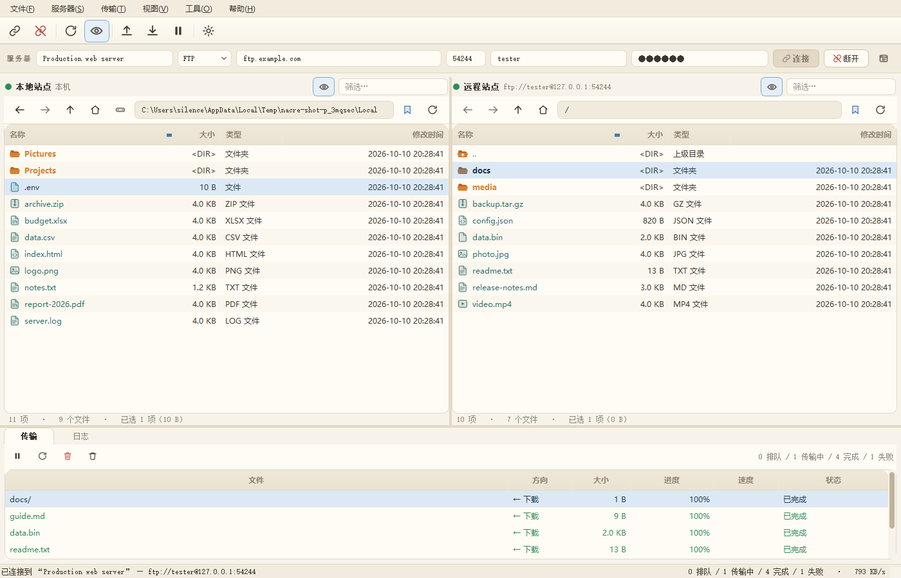
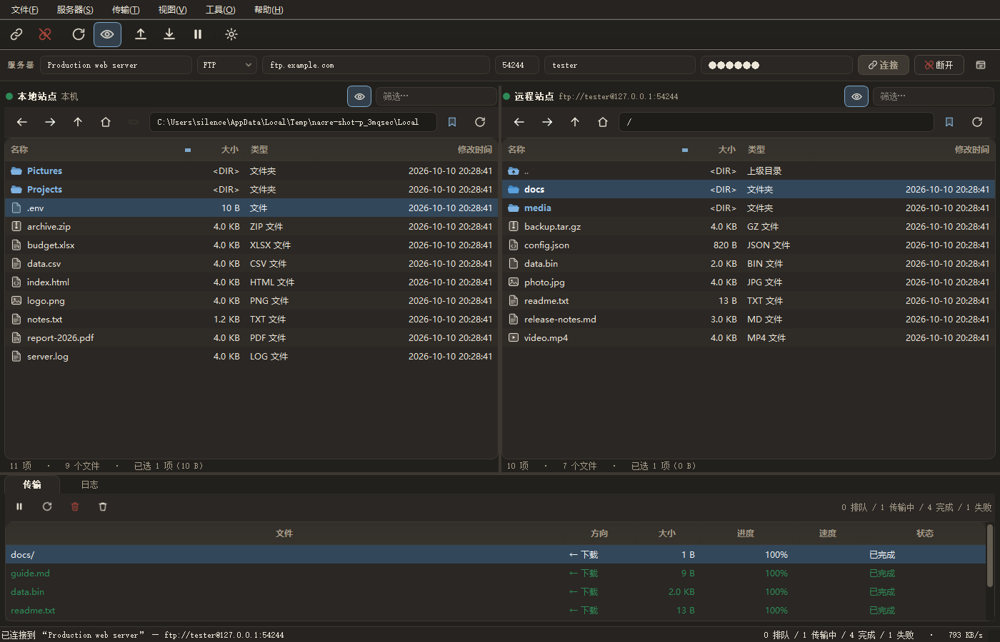

# 青鸟 BlueBird — 现代奶白色 FTP / FTPS / SFTP 客户端

**作者：silence** ｜ 版本 1.0.0

基于 **Python 3.8.3 + PyQt5 5.15.11 + PyQtWebEngine 5.15.7 + paramiko** 实现的
FTP/SFTP 双栏客户端，界面参考 **FileZilla Client** 的信息架构，但换成现代奶白色
（milk-white / cream）视觉风格。


> **名字的由来**：青鸟是中国神话中为王母取食、**传书**的信使鸟，「青鸟传信」
> 即传递音讯。做文件传输客户端，没有比这更贴切的名字。界面语言为中文时显示
> 「**青鸟 BlueBird**」，英文时显示「BlueBird」。

应用图标是**代码画出来的**（`ftpclient/appicon.py`，用 QPainter 绘制一只
**衔着信件的青鸟**），所以任何尺寸都清晰、也不会随附二进制素材：

```bat
:: 重新生成 packaging\bluebird.ico（7 种尺寸）与 version_info.txt（含作者）
D:\DSH_Workspaces\Ftp\python.exe tools\make_icon.py
```

## 一个图形界面

产品只有一个可执行文件 `BlueBird.exe`，双击即可使用。
界面结构参考 FileZilla（左右双栏 + 传输队列 + 日志），
视觉风格为现代奶白色，并且**所有颜色都可自定义**。

内置用户手册（`F1`，或菜单 **Help ▸ User manual**），
手册带**可点击目录**：在程序里、在浏览器里、在 PDF 阅读器里
都能一点跳到对应章节。

## 1. 快速开始

工作区里已经有装好依赖的 Python 3.8.3（`D:\DSH_Workspaces\Ftp`），直接双击：

```
run.cmd
```

或者手动：

```bat
D:\DSH_Workspaces\Ftp\python.exe run.py
```

也支持用 URL 直接发起连接（会带着参数打开连接对话框）：

```bat
run.cmd sftp://deploy@sftp.example.com:22
run.cmd ftp://user@192.168.1.10
```

### 依赖清单（从真实环境导出，已验证）

`requirements.txt` 是**完整清单（25 个固定版本）**，分三段，**每个库都标注了授权协议**：

| 段 | 包数 | 内容 |
|---|---|---|
| **RUNTIME** | 12 | `PyQt5` / `PyQt5-Qt5` / `PyQt5_sip` / `PyQtWebEngine` / `PyQtWebEngine-Qt5` / `paramiko`，加上其传递依赖 `cryptography` / `PyNaCl` / `bcrypt` / `cffi` / `pycparser` / `typing_extensions` |
| **TEST** | 1 | `pyftpdlib`（自动化测试用的内嵌 FTP 服务器） |
| **BUILD** | 12 | `pyinstaller`（锁 5.13.2，6.x 已不支持 Python 3.8）及其依赖，加手册构建工具链 `fonttools` / `brotli` / `PyMuPDF` |

#### 授权协议

| 协议 | 库 |
|---|---|
| **GPL-3.0** | `PyQt5`、`PyQtWebEngine` |
| **LGPL-3.0** | `PyQt5-Qt5`、`PyQtWebEngine-Qt5`（随附的 Qt 库本体，按 LGPL 选项使用） |
| **LGPL-2.1-or-later** | `paramiko` |
| **AGPL-3.0** | `PyMuPDF`（**仅构建手册用，不随 exe 分发**） |
| **Apache-2.0** | `bcrypt`、`PyNaCl`、`brotli`、`importlib_metadata` |
| **Apache-2.0 或 BSD** | `cryptography`（Apache-2.0 / BSD-3-Clause）、`packaging`（Apache-2.0 / BSD-2-Clause） |
| **MIT** | `cffi`、`pyftpdlib`、`altgraph`、`fonttools`、`pefile`、`setuptools`、`zipp` |
| **BSD-3-Clause** | `pycparser`、`pywin32-ctypes` |
| **PSF-2.0** | `typing_extensions` |
| **SIP** | `PyQt5_sip`（Riverbank 自有协议，BSD 风格） |
| **GPL-2.0 + Bootloader 例外** | `pyinstaller`（构建工具；该例外正是允许它打包非 GPL 程序的原因） |

> ⚠️ **分发 exe 前必读**：`PyQt5` 是 **GPL-3.0 或商业授权**二选一。
> 以 GPL-3.0 分发本程序即满足其条件；若要**闭源分发**，必须向 Riverbank
> 购买商业授权。随附的 Qt DLL 走 LGPL 选项（动态链接，满足其条件）。
> 其余库均为宽松协议，只需随二进制附带协议全文。

协议不是手写的，而是**从每个库自己的元数据读取**（`License-Expression` /
`License` / OSI 分类器），并由 `tools/deps_report.py` 的审计步骤**逐一核对**——
本次 25 项全部通过（`all 25 entries agree with the installed metadata`）。
若某个库改了协议，运行该工具会立刻报出来。

#### 本项目的授权与协议文件

| 文件 | 内容 |
|---|---|
| `LICENSE` | **GPL-3.0**：项目声明（名称/版权/免责）+ **GPL 全文**（33 KB），随 exe 分发 |
| `THIRD-PARTY-NOTICES.txt` | 本项目授权说明 + 各依赖的**协议全文**（113 KB），随 exe 分发 |

**为什么本项目必须是 GPL-3.0**：`PyQt5` / `PyQtWebEngine` 是 GPL-3.0 或商业授权
二选一，以 GPL 分发即合规。**若要闭源分发，必须购买 Riverbank 商业授权。**

> **`LICENSE` 只放 GPL 原文**（加开头那几行 GPL 自己要求的声明），**不放补充说明**
> —— GitHub 按文件内容匹配协议来分类，混入额外段落会让它判成 "Other"。
> 项目的授权说明因此放在 `THIRD-PARTY-NOTICES.txt` 开头。
>
> GPL 全文取自本机已安装的 **Qt 运行时 wheel**
> （`PyQt5_Qt5-5.15.2.dist-info/LICENSE`），是权威原文而非手打。第三方协议全文
> 同样**从各 wheel 自带的文件复制**；其中 Qt 那份文件里与 `LICENSE` 重复的
> GPL-3.0 段落已改为指向 `LICENSE`（否则白占 32 KB）。

两个文件都已写进 `packaging/BlueBird.spec`，会出现在 `dist\BlueBird\` 里 ——
MIT / BSD / Apache-2.0 / LGPL 都要求**协议全文随二进制分发**。

重新生成：

```bat
D:\DSH_Workspaces\Ftp\python.exe tools\make_license.py           :: LICENSE
D:\DSH_Workspaces\Ftp\python.exe tools\make_notices.py           :: 第三方协议全文
D:\DSH_Workspaces\Ftp\python.exe tools\make_notices.py --report   :: 只看找到哪些
```

三个关键传递依赖不能省：

* **`PyNaCl`** —— paramiko 的 `ed25519key.py` 里是**裸 `import nacl.signing`**，
  缺了它**所有 `ssh-ed25519` 私钥与主机密钥全部失效**（现代 Linux 服务器主机
  密钥基本都是 ed25519）。它只占 **396 KB**。
* **`bcrypt`** —— 缺了它读不了带口令的 OpenSSH 私钥。
* **`cryptography`** —— FTPS/TLS 以及除 Ed25519 外所有密钥都依赖它。

> ⚠️ `requirements.txt` **必须是纯 ASCII**。pip 在 Windows 上按系统 ANSI 代码页
> （中文系统为 GBK）读取该文件，中文注释会让
> `pip install -r requirements.txt` 直接抛 `UnicodeDecodeError`。
> 生成工具已强制校验这一点。

**重新导出**（读 `importlib.metadata`，自动区分直接依赖 / 传递依赖 / 测试 /
打包，并过滤掉各库自带 `extra` 的开发依赖）：

```bat
D:\DSH_Workspaces\Ftp\python.exe tools\deps_report.py          :: 只报告
D:\DSH_Workspaces\Ftp\python.exe tools\deps_report.py --write  :: 重写 requirements.txt
```

**重新安装**：

```bat
D:\DSH_Workspaces\Ftp\python.exe -m pip install -r requirements.txt ^
    --index-url https://mirrors.aliyun.com/pypi/simple/
```

> **验证方式**：本清单已在**全新 venv** 中实测——25 个包版本与固定值完全一致，
> 应用自检通过（Qt / web engine / PyNaCl / Ed25519 签名 / 手册渲染），
> 两套测试 **69 + 320 全部通过**。这证明清单既**充分**（不缺包）又**最小**
> （无多余包）。
>
> `pyqt5-tools` 不需要：界面全部用纯 Python + QSS + 运行时生成的 SVG 图标写成，
> 没有 `.ui` / `.qrc` 文件，也没有编译步骤。

---

## 2. 界面

```
┌─ 菜单栏 ────────────────────────────────────────────────────────────┐
│ 工具栏（图标式）                                                    │
│ 连接栏：协议 主机 端口 用户 密码 [连接] [断开] [站点管理]           │
├──────────────────────────┬──────────────────────────────────────────┤
│ 本地站点                 │ 远程站点                                 │
│  ◀ ▶ ↑ ⌂ [路径] 时 ⟳      │  ◀ ▶ ↑ ⌂ [路径] 时 ⟳                     │
│  Name Size Type …        │  Name Size Type …                        │
├──────────────────────────┴──────────────────────────────────────────┤
│ [ Transfers ] [ Log ]                                               │
│ 传输队列带进度条 / 彩色日志                                         │
├─────────────────────────────────────────────────────────────────────┤
│ 状态栏：连接信息 · 队列进度 · 实时速率                              │
└─────────────────────────────────────────────────────────────────────┘
```

### 中英文双语切换

界面支持**中文 / English 双语**，可随时切换，**无需重启**：

**View ▸ Preferences ▸ General ▸ Interface language**

- 选「中文」：菜单、按钮、工具栏提示、列标题、文件类型、右键菜单、对话框标题、
  状态栏、传输队列状态全部变中文
- 选 English：全部回到英文
- **即时生效**：`i18n.changed` 信号广播后，主窗口与各面板收到 Qt 的
  `LanguageChange` 事件各自重绘文字
- 选择写入 `settings.json` 的 `appearance.language`，下次启动直接生效
- 语言键以**英文原文**为 key，缺翻译时自动回退英文，不会出现空白或占位符


### 功能一览

* **双栏布局**：左侧本机、右侧服务器，中间分隔条可拖动、可交换左右。
* **主页按钮指向桌面**：本地面板的 ⌂ 按钮打开用户**桌面**目录（通过注册表
  `Shell Folders` 解析，兼容 OneDrive／企业环境下被重定向的桌面；桌面不存在时
  回退到主目录）。远程面板的 ⌂ 仍然是服务器 home。
* **连接保存到 config.ini**：每次连接成功都会自动把 FTP/SFTP 连接信息写进本地
  `config.ini`（含连接名、协议、主机、端口、用户名、密码、私钥、上次目录），
  下次从菜单 **File ▸ Recent connections ▸ Saved connections** 一键直连。
* **导航**：后退 / 前进 / 上级 / 主目录、路径框可直接输入、最近位置下拉、
  路径历史（`Backspace` 后退）、`Alt+↑` 上级。
* **筛选**：每个面板都有实时过滤框，按名字过滤当前目录。
* **显示隐藏文件**：面板上的眼睛按钮（`Ctrl+H`），两侧同步。
* **文件大小自动换算单位**：`0 B` / `999 B` / `1.0 KB` / `5.3 MB` / `1.0 GB` /
  `1.0 TB`（值 ≥ 100 时去掉小数，如 `500 MB`）。远程服务器如果在目录列表里
  没给大小（部分 SFTP 服务器、老式 `LIST` 输出），客户端会**自动在后台逐个
  stat 补齐**；补齐前该行显示 `…`，状态栏显示 `N size(s) pending`。也可手动
  触发 **View ▸ Fetch missing file sizes**。FTP 用 `SIZE` + `MDTM`（先切
  binary 模式），SFTP 用 `stat`。
* **本地盘符切换**：本地面板路径栏的磁盘按钮会列出所有盘符（带类型：
  local disk / removable / network / CD-DVD），并可 **Browse for a folder…**
  选任意目录；在盘符根目录按「上级」会弹出文件夹选择框，不会卡住。
  盘符通过 Win32 `GetLogicalDrives` / `GetDriveTypeW` 枚举，网络盘和可移动盘
  都会列出。
* **文件类型图标**：文件夹、文本、代码、图片、影音、压缩包、文档、可执行文件、
  符号链接各有图标，且**颜色跟随主题实时重绘**。
* **Name 列宽度固定**：不会被窗口或分栏拉伸，长名字自动省略号 + 悬停看全名，
  想改宽度直接拖列边（会记住）。需要“按内容自适应”可在
  **View ▸ Auto-fit the name column** 打开。
* **排序**：点击任意列排序，文件夹始终排在前面（和资源管理器一致）。
* **拖拽传输**：把一个面板里的文件拖到另一个面板即可传输，也支持从
  Windows 资源管理器直接拖文件进来上传。
* **传输队列**：并行传输（默认 5）、暂停/继续、取消、失败自动重试（默认 5 次）、
  失败/完成彩色行、进度条、实时速率、双击失败项看原因。
* **远程文件操作**：新建目录、新建空文件、重命名、递归删除、改权限（CHMOD）、
  计算文件夹大小、属性查看。
* **远程编辑**：内置带等宽字体的编辑器，打开→改→保存回服务器。
* **日志**：带时间戳和等级配色，可保存为文本文件。
* **站点管理**：列出/重命名/删除 config.ini 里的连接，双击即连。
* **窗口状态记忆**：尺寸、分栏位置、当前标签页、列宽、上次用的目录都会恢复。
* **可选列**：Permissions / Owner 默认隐藏（省横向空间），
  **View** 菜单里可打开。

### 快捷键

| 快捷键 | 功能 |
|---|---|
| `Ctrl+N` | 连接服务器 |
| `Ctrl+D` | 断开 |
| `Ctrl+Shift+S` | 站点管理 |
| `F5` | 刷新两个面板 |
| `F2` / `F7` / `Del` | 重命名 / 新建目录 / 删除 |
| `Ctrl+U` / `Ctrl+W` | 上传 / 下载 |
| `Ctrl+P` | 暂停或继续队列 |
| `Ctrl+L` | 显示传输队列 |
| `Ctrl+H` | 显示或隐藏隐藏文件 |
| `Ctrl+,` | 偏好设置 |
| `Ctrl+Shift+X` | 交换左右面板 |
| `Alt+↑` / `Backspace` | 上级目录 / 路径后退 |
| `Ctrl+Q` | 退出 |

---

## 2.5 打包成 exe

`dist\BlueBird\` 是免安装版（**约 280 MB**，不需要装 Python），里面只有**一个程序**：

| 文件 | 说明 |
|---|---|
| `BlueBird.exe` | 图形界面，双击即用 |

重新打包：

```bat
build_exe.cmd
```

它会依次：重新生成图标（含手册里那份副本）→ 重建用户手册 →
调用 PyInstaller → 跑一次 `--selftest` 自检。

单独打包：

```bat
D:\DSH_Workspaces\Ftp\python.exe -m PyInstaller --clean --noconfirm ^
    packaging\BlueBird.spec
```

| 项目 | 说明 |
|---|---|
| 输出 | `dist\BlueBird\`（**on-dir 模式**，不是单文件） |
| 为什么不用单文件 | 单文件每次启动都要把约 280 MB 解压到临时目录，很慢；on-dir 秒开 |
| 手册位置 | `dist\BlueBird\docs\`（**和 exe 同级**，可直接替换成你自己的版本） |
| 自检 | `BlueBird.exe --selftest` → 结果写进当天的 `logs\YYYYMMDD.log` |
| 日志 | `dist\BlueBird\logs\20261011.log` —— 界面 Log 标签页的每一行都在里面，每天一个新文件 |
| 版本号 | `BlueBird.exe --version` |
| 体积构成 | `Qt5WebEngineCore.dll` 97 MB（内置手册渲染必须）、`opengl32sw.dll` 20 MB（无显卡驱动的机器需要）、Qt 其它库 |

**已验证**：`--selftest` 在打包后报告 `frozen: True`、手册 HTML/PDF 均能找到、
QtWebEngine 可用、主窗口构建成功、**手册页面真实渲染完成**；GUI 启动常驻
（约 102 MB 内存）。

### 两本手册：用户手册 与 开发手册

| 手册 | 读者 | 内容 | 是否随 exe 打包 |
|---|---|---|---|
| **用户手册** | 使用者 | 界面、连接、传输、颜色自定义、偏好、快捷键、排错 | ✅ **打包**（`dist\BlueBird\docs\`） |
| **开发手册** | 开发者 | 源码结构、依赖安装、打包、测试、项目布局 | ❌ 只留在仓库里 |

两者都由 `tools/build_manual.py` 从同名 `.md` 生成 HTML + PDF：

```bat
D:\DSH_Workspaces\Ftp\python.exe tools\build_manual.py              :: 两本都建
D:\DSH_Workspaces\Ftp\python.exe tools\build_manual.py --only 开发手册  :: 只建一本
```

> **用户手册里没有**：Python / PyQt5 版本要求、`pip install`、源码目录结构、
> `run.cmd`、项目布局。使用者拿到的是免安装的 `BlueBird.exe`，
> 这些内容对他没有意义，全部只在开发手册里。

| 产物 | 体积 | 目录跳转 |
|---|---|---|
| `docs\用户手册.html` | **约 1.3 MB** | ✅ 点击目录即可跳转（自包含，字体与截图全部内嵌） |
| `docs\用户手册.pdf` | **约 5.2 MB** | ✅ 目录条目可点击 + **PDF 书签大纲**（63 条） |
| `docs\开发手册.html` | **约 1.3 MB** | ✅ 同上 |
| `docs\开发手册.pdf` | **约 5.2 MB** | ✅ 同上 |

> **PDF 从 37 MB 压到 5.2 MB**，靠三件事（都在 `tools/build_manual.py` 里）：
> 1. **字体子集化** —— QtWebEngine 打印 PDF 时不裁剪字体，会把整个
>    `Microsoft YaHei UI`（19 MB）塞进去，**而且塞两份**（常规 + 粗体）。
>    现在用 `fontTools` 按手册实际用到的字符裁剪成 WOFF2，
>    四个字体合计仅约 510 KB（37 MB → 15.5 MB）
> 2. **消除字体回退** —— 页面上任何一个系统字体画不出的字符，WebEngine 都会
>    回退到系统字体，并把**整个字体文件**嵌入（Cambria Math 一个就 9.3 MB）。
>    现在 CSS 里不写任何系统字体名，缺失字符在构建时就替换掉了（15.5 MB → 5.0 MB）
> 3. **截图单次编码** —— 之前内嵌的是「PNG 的 base64 再 base64」，光这一步就
>    浪费 2.4 倍；现在按图选 PNG/JPEG 更小者，只编码一次

> PDF 书签与目录链接由 `PyMuPDF` 在打印后写入 —— QtWebEngine 的
> `printToPdf` **既不生成链接也不生成书签**。

构建手册需要 `fonttools`、`brotli`（写 WOFF2）与 `PyMuPDF`，都已写进
`requirements.txt` 的 BUILD 段；缺任何一个都会打印警告并降级（PDF 会变大或失去目录跳转）。

打包脚本已经剔除了用不到的东西（Qt 自带翻译文件 23 MB、Qt3D/Sensors/Location
等 QML 模块），所以比原始收集结果小约 30 MB。

> 说明：`--selftest` / `--log` / `--version` 是给打包版做无人值守验证用的开关，
> 正常双击 exe 不会用到。

## 3. 连接信息保存在本地 config.ini

**每次连接成功后都会自动保存**，不需要额外勾选。保存位置：

```
%APPDATA%\.bluebird\config.ini
```

（可用环境变量 `BLUEBIRD_CONFIG` 指定别的路径；偏好设置也会有同样路径的提示）

文件内容就是普通 INI，可以直接用记事本编辑、备份或拷到别的机器：

```ini
# BlueBird - saved server connections
# One section per connection. Passwords are stored in clear text: keep this file private.

[Production web server]
name = Production web server
protocol = ftp
host = ftp.example.com
port = 21
user = deploy
password = s3cr3t
remote_dir = /var/www
local_dir = D:/work/site

[Backup NAS]
name = Backup NAS
protocol = sftp
host = 10.0.0.5
port = 22
user = root
password = pw
key_filename = C:/keys/id_rsa
passive = 1
timeout = 30

[connections]
Production web server = Production web server
Backup NAS = Backup NAS
order = Production web server,Backup NAS
```

* `[connections]` 只是给人看的索引（名称 → 区段名），程序靠各自的区段读数据；
  就算删掉这个区段也不影响使用。
* 字段说明：`protocol` 取 `ftp` / `ftps` / `sftp`；`remote_dir`、`local_dir`
  是**这个连接上次用的目录**，下次连接会自动回到那里。

### 连接名（必填）

每个连接都要有名字——这是它在 config.ini 里的标识，也是界面上显示的名字：

* 连接栏第一个输入框就是**连接名**，回车即连；
* 连接对话框第一项也是**连接名**，留空不让确定，右侧 ↺ 按钮可以恢复成
  建议名（`用户名@主机`，非标准端口会写成 `用户名@主机:端口`）；
* 名字可以随时改：**File ▸ Site manager** 里选中连接点 **Rename…**；
* 从站点管理或 Recent connections 里选一个连接再连，**名字会保留**，
  不会被自动生成的名字覆盖；
* 如果你把连接名清空后直接连，程序会自动用 `用户名@主机` 作为名字。

### 自动保存的行为细节

| 情况 | 行为 |
|---|---|
| 连接成功 | 自动写入/更新 config.ini，日志里会提示 `Connection saved to config.ini as "…"` |
| 同一主机 + 用户再次连接 | **更新原记录**，不会产生重复项 |
| 连接栏密码留空重连 | **保留** config.ini 里已存的密码，不会清空 |
| 关闭程序 | 把该连接最后所在的本地/远程目录写回记录 |
| 老版本的 `settings.json` 里的 sites | 首次启动时**自动迁移**进 config.ini（仅在 config.ini 为空时） |

> ⚠️ 密码是**明文**存在 config.ini 里的（INI 格式没有可用的密钥管理）。
> 好处是文件可直接迁移、可被其它工具读取；请自行保证这个文件的访问权限。
> 不想落盘就让连接栏的密码框留空。


### Name 列宽度

「本地/远程」两个面板的 **Name 列不会被拉宽**：

* 列宽默认 260 px，**窗口变大或分栏变化都不会拉伸它**——剩余空间留在右侧；
* 名字太长时显示 `…`，鼠标悬停有完整名字和详情提示；
* 想改宽度：直接拖列边框，宽度会**记住**（存到 settings.json）；
* 想让它按内容自适应：**View ▸ Auto-fit the name column**（默认关闭）。
  关闭该项会恢复你手动设定的宽度，不会被自适应后的宽度覆盖。

`Size / Type / Modified` 三列默认显示，`Permissions / Owner` 默认隐藏，
需要时在 **View** 菜单打开。

---

## 4. 颜色自定义（重点）

打开 **View ▸ Preferences ▸ Colours**（或 `Ctrl+,`）：

* 左侧是分组好的 34 个颜色项：`Interface` / `Lines` / `Text` / `Accent` /
  **`File list items`** / `Status` / `Queued transfers`。
* 顶部搜索框可按名字过滤，例如输入 `folder` 只留下文件夹相关颜色。
* 选中任意一行，下面可以：
  * 直接输入十六进制值（`#2E6FA8`）；
  * 点 **Pick…** 打开取色器；
  * 点 **Reset** 恢复该项默认值，**Reset all** 恢复整套默认。
* 顶部有 4 套预设主题：**BlueBird (cream)**（默认奶白）、**Cloud**、**Matcha**、
  **Linen (dark)**。

### 文件夹与文件的颜色关系

| 元素 | 默认值 | 说明 |
|---|---|---|
| `File list items · Folder` | `#2E6FA8` 蓝 | 文件夹图标与名字 |
| `File list items · Folder (shaded)` | `#23578A` | 文件夹图标顶部折角 |
| `File list items · File` | `#3B352C` | 普通文件名字（默认跟随正文色） |
| `File list items · Symbolic link` | `#2F8F83` | 符号链接 |

**不会冲突**：只要你改颜色，编辑器就会实时做对比度检查，出现下面情况会立刻警告：

* 文件夹色和文件色太接近 → “folders will be hard to pick out”；
* 文件色或文件夹色和面板底色对比度不足；
* 文件夹色和符号链接色太像。





所有颜色改动都是**即时预览**：改一下颜色，两个面板、图标、队列立刻更新；
点 `Cancel` 会还原成打开设置前的样子。

设置保存在 `%APPDATA%\.bluebird\settings.json`（可以用环境变量
`BLUEBIRD_SETTINGS` 指定别的路径）。

---

## 5. 项目结构

```
Ftp Client/
├─ run.py                     启动入口（源码运行）
├─ run.cmd / run_tests.cmd    免配置启动 / 测试
├─ build_exe.cmd              重建手册 → PyInstaller 打包 → 自检
├─ requirements.txt           依赖清单（含每个库的授权协议）
├─ LICENSE                    GPL-3.0 全文（随 exe 分发）
├─ THIRD-PARTY-NOTICES.txt    各依赖协议全文（随 exe 分发）
├─ packaging/
│  └─ BlueBird.spec           PyInstaller 配置（on-dir、剔除无用 Qt 模块）
├─ ftpclient/
│  ├─ app.py                  引导、高 DPI、异常兜底、URL 参数、--selftest
│  ├─ logfile.py              按天分文件的本地日志（logs\YYYYMMDD.log）
│  ├─ main.py                 主窗口：连接栏、双栏、队列、日志、全部业务动作
│  ├─ panes.py                FilePane：面板（导航 + 列表 + 状态 + 大小补齐）
│  ├─ widgets.py              FileTableView（拖拽/列宽）、PathBar（含盘符）、LogView、PaneHeader、进度条代理
│  ├─ dialogs.py              连接对话框、站点管理、偏好设置（含颜色编辑器）
│  ├─ manual.py               内置用户手册窗口（QtWebEngine 渲染 + 导出 PDF）
│  ├─ resources.py            源码 / 打包两种模式下的资源定位
│  ├─ menu.py                 菜单与工具栏
│  ├─ models.py               Entry / FileListModel / TransferItem / TransferModel
│  ├─ session.py              FTP、FTPS、SFTP 统一会话层（不依赖 Qt）
│  ├─ transfer.py             传输队列：线程池、并发、暂停/取消、重试、递归展开
│  ├─ theme.py                调色板 + QSS 生成 + 字体 + 运行时素材
│  ├─ icons.py                运行时着色的 SVG 图标工厂
│  ├─ i18n.py                 中英词条表 + 语言切换 + QMessageBox/按钮本地化
│  ├─ retranslate.py          语言变化时重刷界面的小助手
│  └─ config.py               设置（settings.json）与连接（config.ini）
├─ tests/
│  ├─ ftpserver.py            内嵌 pyftpdlib FTP 服务器
│  ├─ test_ftp_roundtrip.py   会话层端到端测试（69 项）
│  ├─ test_ui_smoke.py        界面无头冒烟测试（320 项）
├─ tools/
│  ├─ screenshot.py           生成文档截图
│  ├─ build_manual.py         由 Markdown 生成两本手册的 HTML / PDF
│  ├─ deps_report.py          导出/审计依赖清单与授权协议
│  ├─ make_notices.py         生成 THIRD-PARTY-NOTICES.txt
│  └─ check_manual.py         检查手册的体积与目录跳转
├─ docs/
│  ├─ 用户手册.md             用户手册源文件（随 exe 打包）
│  ├─ 用户手册.html           自包含 HTML（截图已内嵌）
│  ├─ 用户手册.pdf            A4 打印版（目录可点击 + 书签）
│  ├─ 开发手册.md             开发手册源文件（不打包）
│  ├─ 开发手册.html
│  ├─ 开发手册.pdf
│  └─ screenshots/
└─ dist/BlueBird/             打包产物（BlueBird.exe + docs/ + 运行库）
```

设计上有意把**网络层和界面层完全分开**：`session.py` 和 `transfer.py` 里没有
任何 Qt 代码，所以可以脱离界面直接测试（`tests/test_ftp_roundtrip.py` 就是这么做的）。

---

## 6. 测试

### 用户手册

中文用户手册在 `docs/` 下：

| 文件 | 说明 |
|---|---|
| `用户手册.md` | 源文件（Markdown，便于修改） |
| `用户手册.html` | 自包含 HTML，截图已内嵌 base64，可直接用浏览器打开/打印 |
| `用户手册.pdf` | A4 打印版（由 QtWebEngine 生成） |

内容有改动后重新生成：

```bat
D:\DSH_Workspaces\Ftp\python.exe tools\build_manual.py
```

> PDF 约 36 MB：QtWebEngine 打印时会把整套中文字体嵌进去（实测 90 字节的纯中文
> 页面就会产生约 9.8 MB 的 PDF）。如需小体积 PDF，可把 `用户手册.html` 用
> 浏览器「打印 → 另存为 PDF」或 Word 打开另存，会做字体子集化。

### 自动化测试

```bat
run_tests.cmd
```

或者单独跑：

```bat
D:\DSH_Workspaces\Ftp\python.exe tests\test_ftp_roundtrip.py   :: 69 项
D:\DSH_Workspaces\Ftp\python.exe tests\test_ui_smoke.py        :: 320 项（无头）
```

覆盖范围：

* **会话层 69 项**：连接、banner、MLSD 列目录、目录/文件识别、大小、导航、
  单文件上传下载、内容一致性、2 MiB 大文件往返、进度回调、递归上传计划、
  递归下载、文本读写、mkdir/rename/delete、递归删除、错误处理
  （路径不存在、端口拒绝且报错信息可读）、**7 条 FTP 错误路径必须抛
  `SessionError` 而不是 `TypeError`**、**`SIZE`/`MDTM` 单文件大小查询**、
  取消传输后自动重连。
* **界面层 320 项**：
  * **内置手册与帮助菜单**：资源定位（源码/打包两种模式）、手册 HTML/PDF/MD 均能找到、
    HTML 自包含且已记录新功能、Help 菜单四项齐全、F1 打开手册、Shift+F1 快捷键、
    词条齐备、无 web 引擎时有浏览器回退；
  * **中英文切换**：默认语言、348 条词条、英文直通、未知键回退、无效语言回退、
    切换后菜单/面板/列标题/按钮/选项卡/状态栏/队列表头全部跟着变、
    协议下拉框的 data 不丢、语言偏好落盘、关键字符串无漏翻；
  * **桌面定位**：`local_desktop()` 解析到真实桌面目录（支持注册表重定向），
    且不等于主目录；
  * **config.ini**：新建/更新/查找、按名字与区段查询、空密码不清空已存密码、
    布尔与数字往返、记住上次目录、重命名（保留密码）、删除、重新打开一致、
    损坏文件不崩、`settings.json` 老 sites 自动迁移；
  * **连接名**：默认名 `用户@主机`、非标准端口带端口、可编辑、重连保留原名；
  * **Name 列宽度**：非 Stretch 模式、改窗口宽度列宽不变、长名字不撑宽、
    拖动后持久化、auto-fit 开关正确回退；
  * **文件大小**：各单位换算、缺小数规则、未知大小显示 `…`、后台 stat 补齐、
    补齐后列内容正确、断点续传式的取消、二次触发无待办；
  * **盘符切换**：盘符枚举（带类型标签）、本地面板有磁盘按钮而远程没有、
    逐个盘符切换并核对当前路径、盘符根目录按「上级」不会阻塞；
  * 设置持久化与旧配置兼容、调色板混合/距离算法、QSS 无残留占位符、
    勾选框与箭头素材生成、图标真的画出来了（非全透明）且文件夹/文件不同、
    重新配色后 QSS 与图标同步；
  * 模型排序/过滤/隐藏文件、主窗口构建、双栏导航、隐藏文件开关、
    连接/偏好/站点/编辑器对话框；
  * **通过真实 FTP 服务器跑完整的队列上传下载**（含失败行与清空队列）、
    连接后自动保存到 config.ini、窗口标题带连接名、窗口状态保存、临时素材清理。

> 注：`PyQt5-Qt5` 的 Windows 包不带字体目录，Qt 偶尔会打印
> `QFontDatabase: Cannot find font directory …` —— 这是 Qt 的提示，
> 用的是系统字体，不影响显示。

---

## 7. 已知边界
* **SFTP 需要真实 SSH 服务器**：本机没有可用的 sshd，所以 SFTP 走的是与 FTP
  同一套 `BaseSession` 接口（`listdir / chdir / mkdir / rename / delete /
  delete_recursive / chmod / download_file / upload_file / read_text /
  write_text`），代码完整但未在真实服务器上跑过端到端测试；密码登录、密钥
  登录（可选择私钥文件）、keepalive、严格主机密钥校验都已接好。
* **FTP 强制串行**：同一 FTP 控制连接不能并行传多个文件 —— 实测四个并发下载中
  有三个被截断到 64 KB 且**不报错**，因此队列把 FTP 限为一个一个传（并发设置只对
  SFTP 生效）。SFTP 每个文件独占一条 SSH 通道，并行安全（已实测 4 路 3 MB 全部完整）。
* **传输模式**：默认**二进制**（逐字节）。只有扩展名在 ASCII 白名单里的文件才以
  文本传输，此时会转换换行符（上传 CRLF→LF，下载 LF→CRLF）。ASCII 的白名单为空
  则全部按二进制传输。
* **FTPS** 使用显式 TLS（`AUTH TLS` + `PROT P`），数据通道同样加密。
* 编辑大文件时编辑器会一次性载入内存（超过 4 MB 会先提示确认）。
