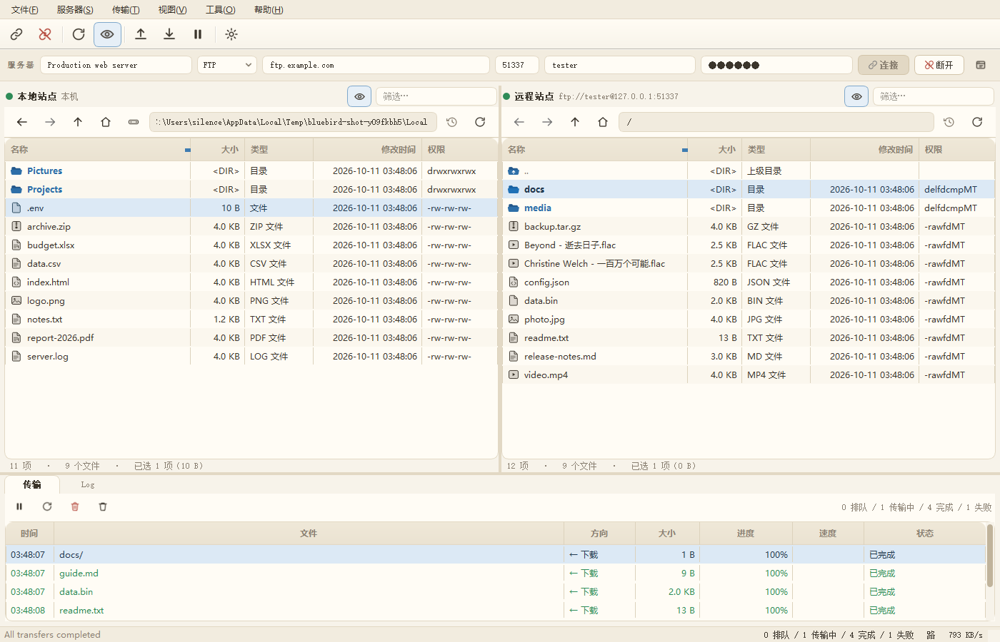
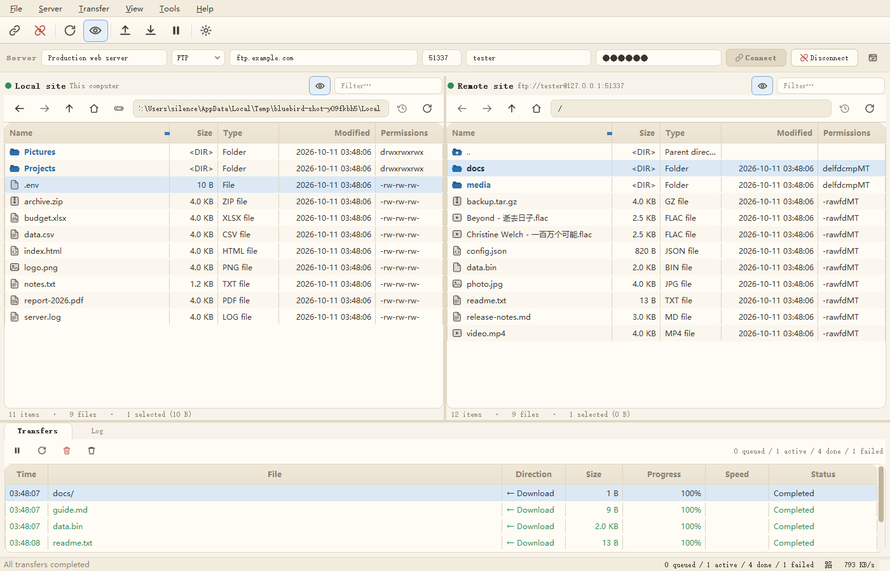
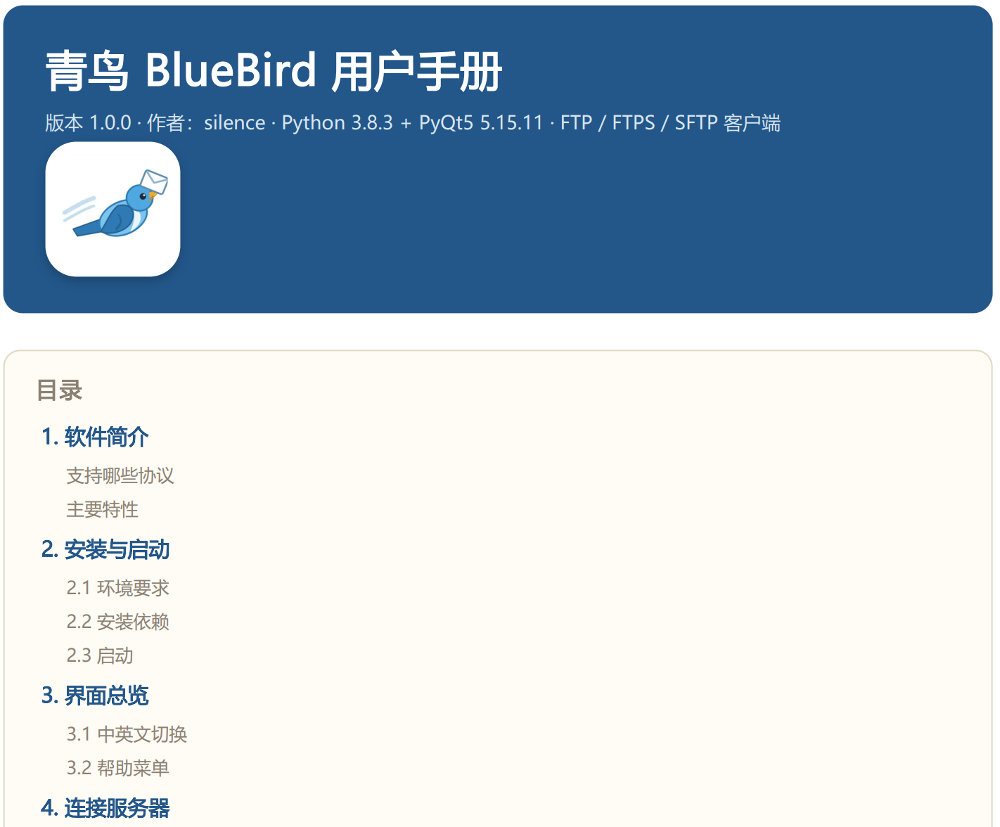
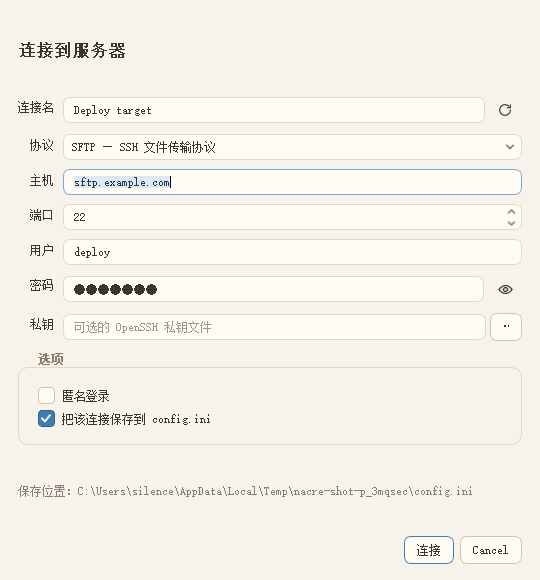
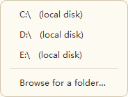
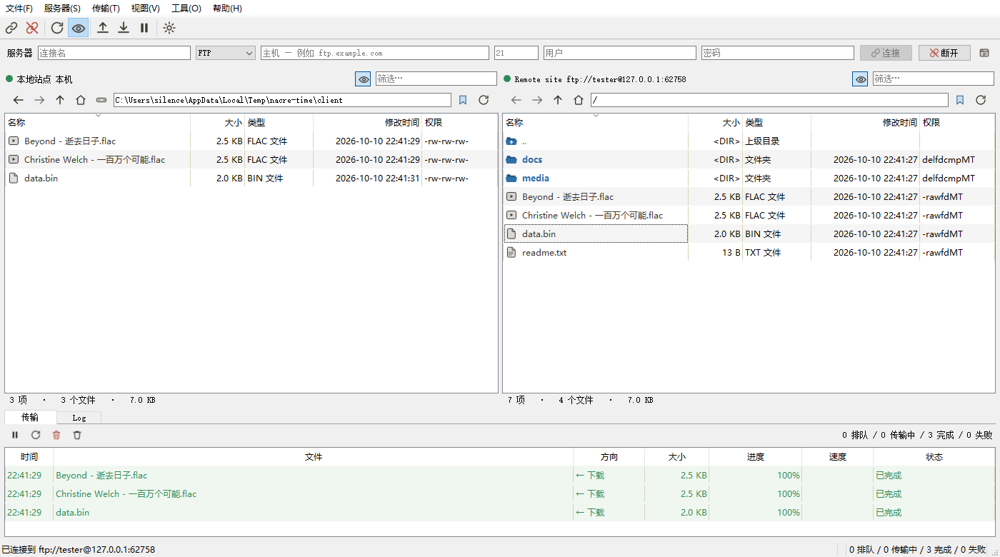
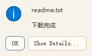
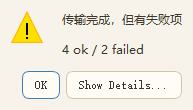
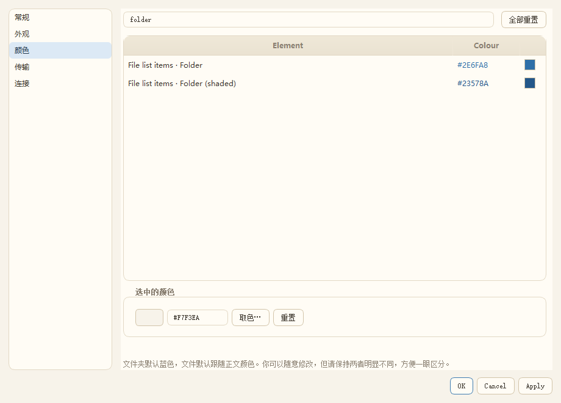
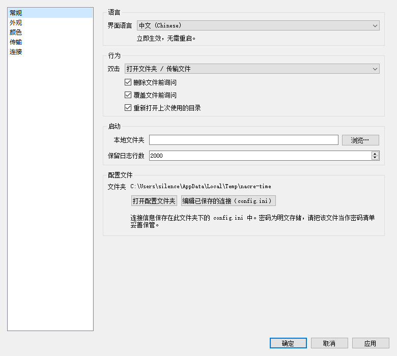

# 青鸟 BlueBird 用户手册

**版本 1.36.2** · **作者：silence** · 适用于打包版 BlueBird.exe · Windows


---

## 1. 软件简介

**青鸟（BlueBird）** 是一个 FTP / FTPS / SFTP 三合一的双栏文件传输客户端。
界面结构参考 FileZilla Client（左右双栏 + 传输队列 + 日志），视觉风格改为
现代奶白色，并且**所有颜色都可以由你自定义**。

> **关于名字**：青鸟是中国神话中为西王母取食、传书的**信使鸟**，
> 「青鸟传信」即指传递消息。文件传输客户端取这个名字，再合适不过。
> 应用图标就是这只**衔着信件的青鸟**。
> 界面语言为中文时显示「青鸟 BlueBird」，英文时显示「BlueBird」。

**Help > About** 里会显示版本、作者与系统信息。

### 支持哪些协议

| 协议 | 说明 | 默认端口 |
|---|---|---|
| **FTP** | 标准文件传输协议，不加密 | 21 |
| **FTPS** | FTP over explicit TLS，控制通道与数据通道都加密 | 21 |
| **SFTP** | SSH File Transfer Protocol，走 SSH 通道，全程加密 | 22 |

### 主要特性

- 双栏布局，本机与服务器对照操作
- 拖拽传输（面板之间拖，也可以从 Windows 资源管理器拖进来上传）
- 传输队列：并发、暂停/继续、取消、失败自动重试、实时速率与进度条
- **传输完成弹窗**（成功/失败/批量汇总）并**自动刷新对应面板**
- **中英文双语**界面，可随时切换、无需重启
- 主页按钮直达**桌面**；本地面板可切换盘符（含网络盘、可移动盘）
- 文件大小自动换算单位（B / KB / MB / GB / TB）
- 服务器不返回文件大小时自动后台补齐
- 远程文件编辑、权限修改、递归删除、文件夹大小统计
- 连接信息自动保存到本地 `config.ini`，可手工编辑与迁移
- 34 项界面颜色全部可改，带冲突检测，内置 4 套主题预设
- **内置用户手册**（Help 菜单，程序内查看 / 导出 PDF）
## 2. 界面总览

```
┌─ 菜单栏（File / Server / Transfer / View / Tools / Help）────────────┐
│ 工具栏：连接 断开 │ 刷新 隐藏文件 │ 上传 下载 暂停 │ 外观设置          │
├─────────────────────────────────────────────────────────────────────┤
│ 连接栏：[连接名] [协议] [主机] [端口] [用户] [密码] [连接][断开][站点] │
├──────────────────────────┬──────────────────────────────────────────┤
│ 本地站点                 │ 远程站点                                 │
│  <   >  ↑ 主页 盘符 [路径] 时 刷新  │  <   >  ↑ 主页 [路径] 时 刷新                       │
│ ┌──────────────────────┐ │ ┌──────────────────────────────────────┐ │
│ │ Name Size Type Mod…  │ │ │ Name Size Type Modified              │ │
│ │ [目录] Projects          │ │ │ [目录] ..                                │ │
│ │ [文件] notes.txt  1.2 KB │ │ │ [目录] docs                              │ │
│ └──────────────────────┘ │ └──────────────────────────────────────┘ │
│ 11 items · 9 files · …   │ 10 items · 7 files · …                   │
├──────────────────────────┴──────────────────────────────────────────┤
│ [ Transfers ] [ Log ]                                               │
│ 传输队列（进度条 / 速率 / 状态）或彩色日志                            │
├─────────────────────────────────────────────────────────────────────┤
│ 状态栏：连接信息 · 队列统计 · 实时速率                               │
└─────────────────────────────────────────────────────────────────────┘
```

各区域说明：

| 区域 | 作用 |
|---|---|
| **工具栏** | 常用操作的图标按钮，鼠标悬停显示名称与快捷键 |
| **连接栏** | 手输连接信息并连接；第一个框是**连接名** |
| **本地面板** | 显示本机文件；有盘符切换按钮 |
| **远程面板** | 显示服务器文件；连接后才有内容 |
| **Transfers 标签** | 传输队列，可暂停/重试/清除 |
| **Log 标签** | 带时间戳和等级配色的日志；**同时写入本地日志文件** |
| **状态栏** | 左：连接状态；中：选中统计；右：队列进度与实时速率 |



### 2.1 日志会存到本地文件

**Log 标签页里出现的每一行，都会同时写进本地日志文件**，方便事后排查问题。

| 项目 | 说明 |
|---|---|
| 位置 | **exe 所在目录**下的 `logs\`（源码运行时为项目根目录） |
| 文件名 | **按年月日命名**，如 `logs\20261011.log` |
| 分天 | **每天一个新文件**；跨过本地零点会自动切换到新文件 |
| 内容 | 时间戳 + 等级（`INFO` / `OK` / `WARN` / `ERROR`）+ 正文 |
| 追加 | 同一天多次启动**追加**到同一文件，不覆盖 |

一次启动的记录长这样：

```
==============================================================================
BlueBird 1.36.2, packaged build
log started 2026-10-11 14:25:18
==============================================================================
2026-10-11 14:25:18  INFO   Connected to ftp://user@host (220 Welcome)
2026-10-11 14:25:18  INFO   Queued download <- 117 KB  (report.pdf -> C:\Users\me\Downloads\report.pdf)
2026-10-11 14:25:18  INFO   Started: DOWNLOAD <- 117 KB (report.pdf)  remote: report.pdf  ->  local: C:\Users\me\Downloads\report.pdf
2026-10-11 14:25:18  OK     Finished report.pdf - 117 KB, 258 KB/s, 0.5 s
2026-10-11 14:25:19  INFO   Queued upload -> 87.9 KB  (C:\work\notes.txt -> /incoming/notes.txt)
2026-10-11 14:25:19  INFO   Started: UPLOAD -> 87.9 KB (notes.txt)  local: C:\work\notes.txt  ->  remote: /incoming/notes.txt
2026-10-11 14:25:19  OK     Finished notes.txt - 87.9 KB, 218 KB/s, 0.4 s
2026-10-11 14:25:19  WARN   Retrying (1/5) report.pdf - timed out
2026-10-11 14:25:20  ERROR  Failed broken.bin - failed - 550 Permission denied
2026-10-11 14:25:20  OK     All transfers completed (3)
```

**传输列表里的每个文件都会记进去**：排队、开始、结果各一行，重试和失败再各补一行。
所以只翻日志就能知道**哪个文件从哪来、去了哪、多大、多快、成没成功**。

打开日志文件夹：**Help > Open the log folder**。

> 日志文件**不会自动删除**（保留全部历史），需要时手动清理即可。
> 如果日志目录不可写（例如装在只读分区），程序**不会报错崩溃**，只在 Log
> 标签页里提示一次「无法写入日志文件」。

### 2.2 中英文切换

界面支持**中文 / English 双语**，可随时切换，**不需要重启**：

**View > Preferences > General > Interface language**

* 选「中文」：菜单、按钮、工具栏提示、列标题、文件类型、右键菜单、
  对话框标题与按钮、状态栏、传输队列状态全部变中文
* 选 English：全部回到英文
* 切换**立即生效**：主窗口与各面板收到语言变更事件后各自重绘文字
* 选择记入 `settings.json`，下次启动直接沿用
* 词条以英文原文为键，缺少译文时自动回退英文，不会出现空白或占位符



### 2.3 帮助菜单

**Help** 菜单里有：

| 菜单项 | 说明 |
|---|---|
| **User manual**（`F1`） | 在**程序内窗口**打开本手册（内置浏览器渲染，可缩放翻页） |
| **Open the manual as PDF** | 用系统默认阅读器打开手册 PDF（可打印、可分发） |
| **Open the documentation folder** | 打开手册与截图所在目录 |
| **Open the log folder** | 打开 `logs\` 日志目录（见 2.1） |
| **Keyboard shortcuts**（`Shift+F1`） | 快捷键速查窗口 |
| **About** | 版本信息 |

程序内手册窗口的工具栏：后退 / 前进 / 手册（回首页）/ 缩小 / 放大 /
**另存为 PDF…**（按当前语言重新导出 PDF）/ 用浏览器打开 / 关闭。



> 手册（HTML + PDF）就在 exe 同级的 `docs\` 目录里，可以直接替换成你自己的版本。

---

## 3. 连接服务器

### 3.1 用连接栏快速连接

1. 在**连接名**框输入一个名字（例如 `Production web server`）；
   留空也可以，程序会自动用 `用户名@主机` 作为名字。
2. 选择**协议**（FTP / FTPS / SFTP）。
3. 填**主机**、**端口**（切换协议时会自动填默认端口）、**用户**、**密码**。
4. 点 **Connect**，或直接按回车。

连接成功后：

- **弹窗提示「连接成功」**，显示 `已连接到 主机:端口` 以及协议与用户名
- 状态栏显示 `Connected to “连接名” — ftp://user@host:port`
- 窗口标题变成 `青鸟 BlueBird [连接名]`（英文界面为 `BlueBird [连接名]`）
- 日志记录 `Connection saved to config.ini as “连接名”`
- 远程面板自动进入该连接上次使用的目录

**连接失败一定会弹窗**，不会静默失败：

| 情况 | 弹窗 |
|---|---|
| 主机/端口不通、被拒绝 | 「连接失败」+ 具体原因（如 `Connection refused`） |
| 用户名或密码错误 | 「连接失败」+ `Authentication failed — check the user name and password` |
| 登录成功但无法进入任何目录 | 「连接失败」，并会先尝试退回到根目录 `/`；只有根目录也打不开才算失败 |
| 打开某个目录失败（连接之后） | 「远程目录无法打开」+ 服务器返回的原因 |

每个弹窗都可以展开**详细信息**（含主机、协议、用户名、目录），方便复制反馈。

> 说明：程序把「能列目录」当作连接成功的判据，而不是只看登录是否通过。
> 因此像「能登录但家目录不存在」这类服务器问题也会在连接阶段就明确报出来。

### 3.2 用连接对话框连接

点 **Connect**（连接栏为空时）或 **File > Connect…**（`Ctrl+N`）打开对话框：

| 字段 | 说明 |
|---|---|
| **Connection name** | **必填**。连接名，留空无法确定。右侧 恢复 恢复建议名 |
| **Protocol** | FTP / FTPS / SFTP |
| **Host** | 主机名或 IP |
| **Port** | 端口，切换协议自动更新 |
| **User** | 用户名；勾选匿名登录后自动填 `anonymous` |
| **Password** | 密码，右侧眼睛图标可查看明文 |
| **Private key** | 仅 SFTP：可选的 OpenSSH 私钥文件（`id_rsa` / `id_ed25519` 等） |
| **Log in anonymously** | 匿名登录 |
| **Save this connection to config.ini** | 默认勾选；取消勾选则本次连接不写入文件 |

对话框底部会显示配置文件的完整路径。



### 3.3 用已保存的连接连接

菜单 **File > Recent connections** 分两组：

- **Saved connections (config.ini)** —— 所有已保存的连接，点一下直连（含密码）
- **Recently used** —— 最近用过的连接名

也可以用 **File > Site manager…**（`Ctrl+Shift+S`）打开站点管理：

- 列表显示所有已保存连接，鼠标悬停看协议/主机/端口/用户/是否保存了密码
- **Connect** —— 连接选中的连接
- **Rename…** —— 重命名（同时更新 config.ini 里的区段与索引）
- **Delete** —— 从 config.ini 删除
- 双击列表项直接连接

### 3.4 SFTP 使用私钥登录

1. 协议选 **SFTP**
2. **Private key** 选你的私钥文件（例如 `C:\Users\你\.ssh\id_ed25519`）
3. 密码可以留空（密码仅用于解密私钥口令）
4. 如果私钥有口令，填在 **Password** 框里

> 服务器主机密钥的严格校验默认**关闭**。首次连接某台服务器后，如果想开启严格
> 校验，去 **Preferences > Connection > Strictly verify SSH host keys** 打勾。
> 开启后未知主机的连接会被拒绝，这是有意为之（防中间人）。

---

## 4. 浏览文件

### 4.1 导航

路径栏（每个面板顶部）按钮含义：

| 按钮 | 作用 | 快捷键 |
|---|---|---|
|  <  | 后退（路径历史） | `Backspace` |
| > | 前进 | — |
| ↑ | 上级目录 | `Alt+↑` |
| 主页 | **主目录**：本地面板打开**桌面**；远程面板打开服务器 home | — |
| 盘符 | **仅本地面板**：切换盘符 / 浏览文件夹 | — |
| 时钟 | 最近访问过的位置 | — |
| 刷新 | 刷新列表 | `F5` |

**关于主页（主目录）按钮**

* **本地面板**：打开当前用户的**桌面**目录。桌面位置是从注册表
  `Shell Folders` 读出来的，所以 OneDrive 或企业策略把桌面重定向到别处时
  也能正确定位；只有在确实找不到桌面目录时才回退到用户主目录。
* **远程面板**：打开服务器的 home 目录（SFTP 用 `normalize(“.”)`，
  FTP 用登录后的工作目录）。
* 如果你在偏好设置里指定了 **Local folder**，本地面板启动时会优先进那个目录，
  但 主页 按钮**始终**去桌面。

路径框可以直接输入路径后回车；也可以粘贴 `\\服务器\共享` 这类 UNC 路径。

### 4.2 切换盘符（本地面板）

点路径栏的**磁盘按钮**：

- 列出本机所有盘符，并标注类型：`local disk` / `removable` / `network` / `CD/DVD`
- **网络盘和可移动盘都会列出**（用 Win32 API 枚举，比逐个字母试探可靠）
- 底部 **Browse for a folder…** 可直接跳转任意目录

在盘符根目录按「上级」会弹出文件夹选择框（根目录已经没有上级了）。

### 4.3 右键菜单

在每个面板里**右键**会弹出针对该面板的菜单，内容随选中项变化：

| 本地面板 | 远程面板 |
|---|---|
| 上传到服务器 | 下载到本地文件夹 |
| 新建文件夹… | 新建目录… / 新建空文件… |
| **新建文件夹并进入…** | **新建目录并进入…** |
| 刷新 | 刷新列表 |
| 重命名… / 删除 | 编辑 / 重命名… / 删除 |
| 属性 | 计算文件夹大小（选中单个目录时） |
| — | 权限… / 属性 |

> **新建…并进入**：输入名字后**直接进入新目录**，省掉「新建」再「双击进入」两步。
> 同名目录**已经存在就直接进入它**、不会报错，所以可以放心重复按。

菜单**跟随界面语言**（中英文都会一起切换），不是固定英文。

### 4.4 文件列表

| 列 | 含义 |
|---|---|
| **Name** | 文件名，文件夹蓝色加粗，符号链接斜体青色 |
| **Size** | 大小，自动换算单位；文件夹显示 `<DIR>`；未知显示 `…` |
| **Type** | 类型（Folder / TXT file / ZIP file …） |
| **Modified** | 修改时间 |
| **Permissions** | 权限（**默认显示**，可在 View 菜单关掉） |
| Owner | 属主（默认隐藏，View 菜单开启） |

**Name 列宽度是固定的**：窗口放大或拖动分隔条都不会拉伸它，多余空间留在右侧。
名字太长会显示 `…`，鼠标悬停可看完整名称与详情。

列与列之间有**细分隔线**，从表头一直画到最下面一行，所以列很多时也能一眼看清
每个值属于哪一列（颜色可在偏好设置里用 `Grid line` 单独调整）。

#### 权限列的两种显示

不同服务器给出的权限信息不同，本客户端会挑**服务器真正提供的**那种来显示，
不会编造：

| 服务器返回 | 显示样子 | 含义 |
|---|---|---|
| MLSD 带 `unix.mode`（ProFTPD、vsftpd 等） | `-rw-r--r--`、`drwxr-xr-x` | 标准 Unix 权限位 |
| LIST 的 `ls -l` 输出 | `-rw-r--r--`、`lrwxrwxrwx` | 标准 Unix 权限位 |
| 只有 MLSD 的 `perm` 事实（pyftpdlib、pure-ftpd、IIS 等） | `-rawfdMT`、`delfdcmpMT` | **当前账号被允许的操作**，不是权限位 |
| 什么都没给 | 空白 | 服务器没有提供 |

第二种情况按 **RFC 3659** 定义显示，字母含义：
`e` 进入 · `l` 列出 · `r` 读取 · `a` 追加 · `w` 写入 · `f` 改名 ·
`d` 删除 · `c` 新建 · `m` 建目录 · `p` 删除目录内文件 · `M`/`T` 设置修改时间。
首字母是类型：`-` 文件、`d` 目录、`l` 链接。

> 为什么不做成 `-rw-r--r--` 的样子？因为 `perm` 描述的是**你这份账号能做什么**，
> 而不是文件的权限位，硬套成 Unix 格式会是**假信息**。把鼠标悬停在文件上，
> 提示框会把字母展开成单词（例如 `read, append, write, rename, delete`）。

想改宽度：直接拖列边框，宽度会被记住。
想让列宽按内容自适应：**View > Auto-fit the name column**（默认关闭）。

### 4.5 排序与筛选

- 点任意列标题排序；再点一次切换升/降序
- **文件夹始终排在最前面**（和 Windows 资源管理器一致）
- 每个面板的 **Filter…** 框可实时按名字过滤当前目录

### 4.6 隐藏文件

面板上的眼睛按钮，或 `Ctrl+H`，或菜单 **View > Show hidden files**。
两个面板同步生效，设置会被记住。

### 4.7 文件大小自动补齐

有些服务器在目录列表里不返回文件大小（部分 SFTP 服务器、老式 `LIST` 输出）。
这种情况下：

1. 该行 Size 列先显示 `…`
2. 状态栏显示 `N size(s) pending`
3. 客户端**自动在后台逐个查询**（FTP 用 `SIZE`/`MDTM`，SFTP 用 `stat`），
   每 20 个刷新一次界面，不影响你继续操作
4. 补齐后显示真实大小；服务器确实没有则显示 `0 B`

也可以手动触发：**View > Fetch missing file sizes**。

> 如果补齐后仍然显示 `…`，说明该服务器拒绝 `SIZE`/`stat`，日志里会记录
> `N file size(s) unavailable`。



---


---

## 5. 传输文件

### 5.1 三种操作方式

| 方式 | 操作 |
|---|---|
| **按钮 / 菜单** | 选中文件 → `Ctrl+U` 上传 / `Ctrl+W` 下载 |
| **双击** | 本地面板双击文件 = 上传；远程面板双击文件 = 下载 |
| **拖拽** | 从本地面板拖到远程面板 = 上传；反向 = 下载；也可从资源管理器拖文件进远程面板 |

> 双击文件夹是**进入该目录**，不是传输。

### 5.2 传输队列（Transfers 标签）

| 列 | 含义 |
|---|---|
| **Time** | **时:分:秒**。排队时显示入队时刻，开始传输后固定为开始时刻，不会跳变 |
| File | 文件名（目录带 `/` 后缀） |
| Direction | `Upload →` 或 `← Download` |
| Size | 文件大小 |
| Progress | 进度条 + 百分比 |
| Speed | 实时速率 |
| Status | Queued / Transferring / Completed / Failed / Cancelled |

行背景色：排队=米色、传输中=浅蓝、完成=浅绿、失败=浅红。

队列工具栏按钮：

| 按钮 | 作用 |
|---|---|
| 暂停 / > | 暂停 / 继续整个队列（`Ctrl+P`） |
| 刷新 | 重试失败的项目 |
| [删除] | 从列表移除选中项 |
| [清理] | 清除已完成/已失败的项目 |

双击失败的项会弹窗显示失败原因。右键也有同样的菜单。



### 5.3 覆盖确认

当目标位置已有同名文件时，会询问 **Yes / No / YesToAll（是 / 否 / 全是）**。

> **「全是」只对当前这一批生效**，批次结束后自动恢复询问。
> 想永久关闭，去 **偏好设置 > 常规 > 覆盖文件前询问** 取消勾选
> （默认是勾选的）。
选 **YesToAll** 会关闭后续的覆盖提示（等于把偏好里的“覆盖前询问”关掉，可在
偏好设置里重新打开）。

**想重新打开覆盖提示**：**偏好设置 > 常规 > 覆盖文件前询问**
（默认勾选）。旧版本点「全是」会永久把该选项关掉且没有入口可以打开，
现在「全是」只在当前批次内有效。

### 5.4 目录传输

- 上传目录：递归创建远程目录结构并上传其中所有文件
- 下载目录：递归创建本地目录结构并下载其中所有文件
- 符号链接默认**不跟随**（避免循环）

### 5.5 并发数

**Preferences > Transfers > Simultaneous transfers** 默认 **5**，可设 1–16。

> **FTP 始终串行**：同一条 FTP 控制连接无法并行传多个文件（会抢同一个数据套接字，实测会导致文件被**截断且不报错**），所以 FTP 会被自动限为 1。这个值对 **SFTP** 生效。

- **SFTP**：真正并行，多个文件同时传，速度更快
- **FTP/FTPS**：同一条控制连接无法并行传多个文件，实际会被自动串行化，
  不会出错，但也不会更快。传 FTP 时设 1 即可

### 5.6 失败重试

**Preferences > Transfers > Automatic retries** 可设 0–10 次。
失败的项目会自动排队重试，状态列显示 `retrying (n)`。

### 5.7 传输完成提示与自动刷新

每个传输（或一批传输）结束时会**弹窗告知结果**，并**自动刷新对应面板**，
新文件立刻出现在列表里。

**弹窗规则**

| 情况 | 弹窗内容 |
|---|---|
| 单个下载成功 | 标题「下载完成」，显示文件名，展开详情可看目标目录 |
| 单个上传成功 | 标题「上传完成」，同上 |
| 单个失败 | 标题「下载/上传完成，但有失败项」，显示**服务器的原始报错**，详情里有源路径与目标路径 |
| 一批全部成功 | 标题「传输完成」，显示 `N ok / 0 failed` |
| 一批有失败 | 标题「传输完成，但有失败项」，显示 `N ok / M failed`，点 **显示详细信息** 可看到每个失败项及原因（最多 12 条，其余折叠） |
| 传输被取消 | 不当作失败；全部取消时提示「传输已取消」 |

**批量合并**：一次拖入多个文件/整个目录时，**只弹一次**窗口（等队列跑完再汇总），
不会每个文件弹一次。弹窗是模态的，关掉后才会弹出下一批的结果。

**自动刷新**：传输完成后，只有**目标目录正是当前面板显示的目录**时才刷新，
所以你在浏览别的目录时不会被打断：

* 下载完成 → 若本地面板正显示该目录，本地面板刷新
* 上传完成 → 若远程面板正显示该目录，远程面板刷新

**开关**（**Preferences > Transfers > Notification**）：

| 选项 | 默认 | 说明 |
|---|---|---|
| Show a popup when a transfer finishes | 开 | 关掉就只记日志、不弹窗 |
| Refresh the pane when a transfer finishes | 开 | 关掉就只弹窗、不刷新列表 |

日志里始终会记录 `Queue finished: N completed, M failed`，
状态栏也会显示 `Transfers finished — N failed`。





### 5.8 传输报错但文件其实已下载完整？

**1.0.0 已修复**。旧版偶发「226 Transfer complete.」被当成失败，原因是：

* `ftplib.voidresp()` 只接受 2xx，且抛出异常时**直接把响应原文当错误消息**。
  部分服务器（或中间的代理）在传输结束后会**多发一行 226**，于是传输明明成功，
  却被报成失败，消息就是 `226 Transfer complete.`
* 多出来的那行还会**污染控制通道**：后面每条命令都读到上一条的响应，
  于是出现 `550 SIZE not allowed in ASCII mode` 之类的假错误，
  而且会**连续影响后续文件**（这就是为什么总是固定某几个文件失败）。

现在的处理：

| 措施 | 效果 |
|---|---|
| 传输结束后**排空**控制通道里多余的 2xx | 成功的传输不再被误报为失败 |
| 发命令前清掉**遗留的 2xx** | 后一个文件不受前一个的影响（FTP 每条命令只有一个响应，所以发命令前还等着的响应一定是多余的） |
| `SIZE` 查询先切二进制模式，失败**不影响传输** | 不再出现 `550 SIZE not allowed in ASCII mode` |
| 首次建立数据连接被拒时**排空并重试一次** | 偶发错位可自动恢复 |
| 下载前先检查取消状态 | 取消的传输不会向服务器发出半截命令 |

如果你仍看到下载报错，请把**日志标签页**里的完整内容发我——里面能看出是服务器拒绝、
权限不足、磁盘满，还是路径问题。


### 5.9 大批量文件不再卡顿

一次加入**数百个文件**（或总体积达到几 GB）时，以前会先卡住很久才开始传输。
原因是**每个文件都单独向服务器询问一次目录**（用来判断是否需要覆盖）：
600 个文件就是 600 次网络往返，实测约 **33 秒**。

现在**每批只列一次目录**，同样 600 个文件约 **0.2 秒**完成入队；下载侧也合并了
本地目录的创建与存在性检查。多大的批量都能立即开始传输。

---

## 6. 远程文件操作

在远程面板**右键**选中项，或使用 **Server / Tools** 菜单：

| 操作 | 快捷键 | 说明 |
|---|---|---|
| 新建目录 | `F7` | 在当前远程目录创建 |
| 新建目录并进入 | — | 建好后**直接进入**；同名已存在则进入不报错 |
| 新建空文件 | — | 创建一个 0 字节文件 |
| 重命名 | `F2` | SFTP 优先用 `posix_rename`（可覆盖已存在目标） |
| 删除 | `Del` | 目录会**递归删除**，删除前有确认 |
| 编辑 | — | 内置等宽字体编辑器，改完保存回服务器（>4 MB 会先提示） |
| 权限（Permissions…） | — | 输八进制模式，如 `644`、`755`（FTP 走 `SITE CHMOD`，需服务器支持） |
| 计算文件夹大小 | — | 递归统计文件数与总大小 |
| 属性 | — | 显示名称、路径、类型、大小、修改时间、权限、属主、链接目标 |

本机面板右键菜单：上传、新建文件夹、**新建文件夹并进入**、刷新、重命名、删除、属性。

---

## 7. 连接管理（config.ini）

### 7.1 自动保存

**每次连接成功后都会自动保存**，不需要额外操作。保存位置：

```
%APPDATA%\.bluebird\config.ini
```

（可用环境变量 `BLUEBIRD_CONFIG` 指定其他路径）

### 7.2 文件格式

纯 INI 文本，可以直接用记事本编辑、备份、迁移到其他机器：

```ini
# BlueBird - saved server connections
# One section per connection. Passwords are stored in clear text: keep this file private.

[Production web server]
name = Production web server
protocol = ftp
host = ftp.example.com
port = 21
user = deploy
password = s3cr3t
remote_dir = /var/www
local_dir = D:/work/site

[Backup NAS]
name = Backup NAS
protocol = sftp
host = 10.0.0.5
port = 22
user = root
password = pw
key_filename = C:/keys/id_rsa
passive = 1
timeout = 30

[connections]
Production web server = Production web server
Backup NAS = Backup NAS
order = Production web server,Backup NAS
```

字段说明：

| 字段 | 说明 |
|---|---|
| `name` | 连接名（显示用） |
| `protocol` | `ftp` / `ftps` / `sftp` |
| `host` / `port` | 主机与端口 |
| `user` / `password` | 用户名与密码 |
| `key_filename` | SFTP 私钥路径 |
| `passive` | `1`/`0`，FTP 被动模式 |
| `timeout` / `keepalive` | 超时与心跳（秒） |
| `remote_dir` | **该连接上次用的远程目录**，下次自动进入 |
| `local_dir` | **该连接上次用的本地目录** |

`[connections]` 只是给人看的索引（名称 → 区段名），程序不依赖它，删掉也能用。

### 7.3 保存行为细节

| 情况 | 行为 |
|---|---|
| 连接成功 | 自动写入/更新 config.ini，日志提示保存的连接名 |
| 同一主机 + 用户再次连接 | **更新原记录**，不会产生重复项 |
| 连接栏密码留空重连 | **保留** config.ini 里已存的密码，不会清空 |
| 关闭程序 | 把该连接最后所在的本地/远程目录写回记录 |
| 连接名重复 | 自动加后缀，如 `web (2)` |
| 旧版本 `settings.json` 里的站点 | 首次启动自动迁移进 config.ini（仅当 config.ini 为空） |

> **安全提示**：密码在 config.ini 里是**明文**保存的。INI 格式没有可用的密钥
> 管理，这样做是为了让文件可以直接迁移、被其他工具读取。请自行保证该文件的
> 访问权限。不想落盘就让连接栏的密码框留空后再连接。

### 7.4 连接名规则

- 建议名格式：`用户名@主机`；非标准端口写成 `用户名@主机:端口`（如 `u@h:2121`）
- 连接对话框里留空无法确定；连接栏留空则自动使用建议名
- 从站点管理或最近连接再次连接时，**原名字会保留**，不会被自动名覆盖

---

## 8. 外观与颜色自定义

打开 **View > Preferences > Colours**（或 `Ctrl+,`）。

### 8.1 颜色编辑器

- 左侧导航分组共 **34 项颜色**：`Interface` / `Lines` / `Text` / `Accent` /
  **`File list items`** / `Status` / `Queued transfers`
- 顶部**搜索框**按名字过滤，例如输入 `folder` 只显示文件夹相关颜色
- 选中任意一行，下方可：
  - 直接输入十六进制值（如 `#2E6FA8`）
  - 点 **Pick…** 打开系统取色器
  - 点 **Reset** 恢复该项默认值，**Reset all** 恢复整套默认
- 右侧色块实时显示当前颜色

### 8.2 主题预设

**Appearance** 页顶部可选择 4 套预设（会替换整套调色板）：

| 预设 | 风格 |
|---|---|
| **BlueBird (cream)** | 默认，奶白色 |
| **Cloud** | 冷色调浅灰蓝 |
| **Matcha** | 抹茶绿 |
| **Linen (dark)** | 深色 |

### 8.3 文件夹与文件的颜色

| 元素 | 默认值 | 作用 |
|---|---|---|
| `File list items · Folder` | `#2E6FA8` 蓝 | 文件夹图标与名字 |
| `File list items · Folder (shaded)` | `#23578A` | 文件夹图标顶部折角 |
| `File list items · File` | `#3B352C` | 普通文件名（默认跟随正文色） |
| `File list items · Symbolic link` | `#2F8F83` | 符号链接 |

**默认不会冲突**：文件夹是蓝色，文件是正文深灰棕，天生区分明显。



改颜色时编辑器会**实时做对比度检查**，出现下列情况会立刻警告：

- 文件夹色和文件色太接近 → 难以快速区分
- 文件色或文件夹色与面板底色对比度不足
- 文件夹色和符号链接色太像

### 8.4 即时预览

所有颜色改动都是**即时生效**的：两个面板、图标、图标颜色、队列行颜色都会立即
重绘。点 **Cancel** 会还原成打开设置前的样子；点 **OK** 或 **Apply** 才写入文件。

---

## 9. 偏好设置详解
### 9.1 General（常规）
| 选项 | 说明 |
|---|---|
| Double click | `Open the folder / transfer the file`（默认）或 `Always transfer` |
| Ask before deleting files | 删除前确认，默认开 |
| Ask before overwriting files | 覆盖前确认，默认开 |
| Reopen the last used directories | 记住并恢复上次的本地/远程目录，默认开 |
| Local folder | 启动时本地面板打开的目录 |
| Log lines kept | 日志保留行数（100–20000） |

### 9.2 Appearance（外观）
| 选项 | 说明 |
|---|---|
| Theme preset | 4 套预设主题 |
| Interface font / Font size | 界面字体与字号（`default` 表示跟随系统） |
| Row height | 文件列表行高（18–48 px） |
| Icon size | 文件图标大小（12–32 px） |
| Alternating row colours | 隔行变色 |
| Show grid lines | 显示网格线 |

### 9.3 Transfers（传输）
| 选项 | 说明 |
|---|---|
| Simultaneous transfers | 并行传输数量，**默认 5**，可设 1–16（FTP 自动限为 1） |
| Automatic retries | 失败自动重试次数，**默认 5**，可设 0–20 |
| Keep the original modification time | 传输后保留原修改时间 |
| **Notification** | |
| Show a popup when a transfer finishes | 传输完成后弹窗提示（默认开） |
| Refresh the pane when a transfer finishes | 传输完成后刷新对应面板（默认开） |
| ASCII extensions | **只有这些扩展名**以文本（ASCII）方式传输，其余一律**二进制**（逐字节）。留空则全部二进制 |
|   └ 转换换行符 | ASCII 会**转换换行符**：下载把服务器的 LF 转为本地的 CRLF（Linux \\n → Windows \\r\\n），上传反之。它会**破坏非纯文本文件**，所以名单宜短 |

### 9.4 Connection（连接）
| 选项 | 说明 |
|---|---|
| Connection timeout | 连接超时（5–600 秒） |
| Keep-alive interval | 心跳间隔，`off` 表示关闭 |
| Use passive mode | FTP/FTPS 被动模式，默认开 |
| Strictly verify SSH host keys | SFTP 严格校验主机密钥，默认关 |
| FTP encoding | FTP 控制通道编码，默认 `utf-8` |

---

## 10. 键盘快捷键
### 连接

| 快捷键 | 功能 |
|---|---|
| `Ctrl+N` | 打开连接对话框 |
| `Ctrl+D` | 断开连接 |
| `Ctrl+Shift+S` | 站点管理 |

### 导航

| 快捷键 | 功能 |
|---|---|
| `F5` | 刷新两个面板 |
| `Alt+↑` | 上级目录 |
| `Backspace` | 路径后退 |
| `Ctrl+H` | 显示/隐藏隐藏文件 |
| `Ctrl+L` | 显示传输队列 |
| `Ctrl+Shift+X` | 交换左右面板 |
| `Ctrl+,` | 打开偏好设置 |

### 文件操作

| 快捷键 | 功能 |
|---|---|
| `F2` | 重命名 |
| `F7` | 新建目录 |
| `Del` | 删除选中项 |
| `Ctrl+U` | 上传本地选中项 |
| `Ctrl+W` | 下载远程选中项 |
| `Ctrl+P` | 暂停/继续队列 |

### 其他

| 快捷键 | 功能 |
|---|---|
| `F1` | 快捷键帮助 |
| `Ctrl+Q` | 退出 |
## 11. 文件位置与备份
| 内容 | 路径 | 环境变量覆盖 |
|---|---|---|
| 偏好设置与颜色 | `%APPDATA%\.bluebird\settings.json` | `BLUEBIRD_SETTINGS` |
| 保存的连接 | `%APPDATA%\.bluebird\config.ini` | `BLUEBIRD_CONFIG` |

**备份**：复制这两个文件即可。**迁移到新机器**：把两个文件放到新机器的同一位置
（注意路径中的本机目录可能需要调整）。

**不想手动找目录**：**偏好设置 > 常规 > 配置文件** 里有两个按钮：

| 按钮 | 作用 |
|---|---|
| **打开配置文件夹** | 在资源管理器里打开存放这两个文件的目录 |
| **编辑已保存的连接（config.ini）** | 直接用默认编辑器打开 `config.ini`（不存在时会先建一个空文件） |

同一栏里还会显示该目录的完整路径，方便复制。



**恢复出厂设置**：删除 `settings.json`（连接会保留）；两个都删则全部重置。

程序**不写注册表**，卸载只需要删除程序目录与上述配置目录。

---

## 12. 常见问题排查
### 连不上服务器

| 现象 | 可能原因与处理 |
|---|---|
| `Connection refused - is the server running, and is the port right?` | 端口不对，或服务器没启动，或防火墙拦截 |
| `Host not found - check the server name` | 主机名拼错，或 DNS 解析失败 |
| `Connection timed out` | 网络不通，或被防火墙丢包（可在偏好里加大超时） |
| `Authentication failed - check the user name and password` | 用户名或密码错误（SFTP 时也可能是私钥不对） |
| `Server refused the command (530 …)` | 服务器拒绝登录，常见于未授权 IP 或账号被锁 |

### 中文文件名显示乱码

FTP 服务器编码不一致导致。到 **Preferences > Connection > FTP encoding**
尝试改为 `gbk` 或 `latin-1`。SFTP 一律使用 UTF-8，正常不会乱码。

### 远程文件大小显示 `…` 或 `0 B`

该服务器未在目录列表里返回大小，且拒绝 `SIZE`/`stat` 查询。日志里会有
`N file size(s) unavailable`。这不影响传输，只是无法预显示大小。

### 权限修改失败

`SITE CHMOD` 不是标准 FTP 命令，很多服务器（尤其 Windows FTP）不支持。
SFTP 的 `chmod` 一般都能用。

### 传输中途卡住或取消后无法继续

对 FTP 取消传输会关闭控制连接（协议决定），下次操作会自动重连。日志里会记录。
SFTP 取消只关闭当前文件句柄，连接保持。

### 端口 21 上用 SFTP

如果服务器确实是 SSH 监听在 21 端口，选 SFTP + 端口 21 即可；
否则请确认服务端配置，或改用标准的 22 端口。

### 界面字体缺失提示

控制台可能打印 `QFontDatabase: Cannot find font directory …`。
这是 PyQt5-Qt5 的 Windows 包不带字体目录导致的提示，程序使用系统字体，
**不影响任何功能**。

---

## 13. 已知限制
1. **SFTP 已在真实服务器上验证**：OpenSSH 9.9（Ubuntu，`silence@192.168.31.142:22`）
   密码登录、目录列表、权限列均实测通过。私钥登录、keepalive、严格主机密钥校验
   这几条路径仍建议在自己的服务器上确认一次。
2. **FTP 强制串行传输**。同一条 FTP 控制连接不能并行传多个文件：实测四个并发下载中有三个被截断到 64 KB 且**不报错**。因此队列会把 FTP 限为一个一个地传；SFTP 每个文件独占一条通道，并行安全（已实测）。
3. **密码明文存储**在 config.ini 中，见 7.3 节的安全提示。
4. **编辑器一次性载入整个文件**，超过 4 MB 会先提示确认，不适合编辑超大文件。
5. **Owner 列默认隐藏**（省约 92 px）；**Permissions 列默认显示**。
   两列都可以在 **View** 菜单里随时开关。
6. **权限列的显示形式取决于服务器**：给出 `unix.mode` 时显示
   `-rw-r--r--` 这样的权限位；只给 MLSD `perm` 时显示该账号被允许的
   操作字母（如 `-rawfdMT`）——详见 4.4 节。两者含义不同，客户端不会
   把后者硬套成 Unix 格式。
7. **严格的 SSH 主机密钥校验默认关闭**，首次连接前请确认服务器身份。

---

*本手册对应 BlueBird 1.36.2。菜单或界面文字以程序内实际显示为准。*
